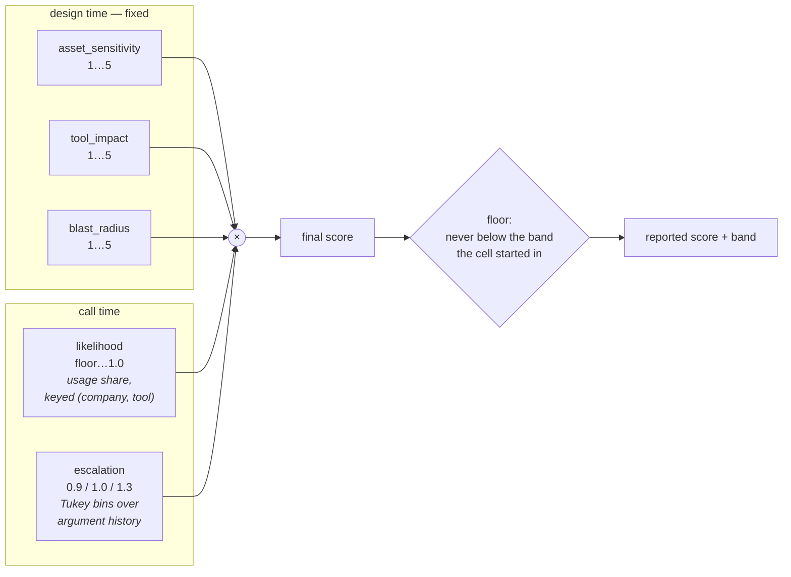
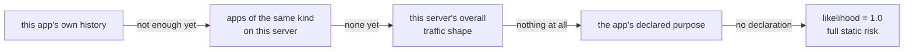

# Dynamic Layer — Design

The conceptual design for the runtime layer that sits on top of the static severity
matrix. Companion to [Gateway Bundle Review](gateway-bundle-review.md), which
reviews an external implementation of the same idea.

Every mechanism below is explained plainly and shown working on one example.
Measurements are deliberately kept out of the explanation and collected in the
appendix at the end.

## The organising principle

The way these systems go wrong is that every new signal invents its own multiplier,
and then nobody can defend the numbers. The way out:

> **A dynamic signal does not get its own scale. It moves a dimension the severity
> matrix already has.**

The matrix is `asset_sensitivity × blast_radius × likelihood × tool_impact`. Two of
those describe the world and one call cannot change them. Two describe the call.

| dimension | set by | can one call move it? |
|---|---|---|
| `asset_sensitivity` | the org's policy register | **no** — design time |
| `tool_impact` | the tool's semantics | **no** — design time |
| `likelihood` | pinned at 1.0 by the scan | **yes** — the slot the runtime exists to fill |
| `blast_radius` | the scan assumes a typical call | **only within bounds** — argument size may nudge it |



Because every dimension already has a published range, the range questions answer
themselves. There is nothing new to calibrate.

**And the output is a ranking, not a verdict.** The layer never blocks; it reports a
score, and the question it must answer is whether a misusing call scores above the
ordinary calls around it. Every measurement in this document is therefore a ranking
measurement, not a flag rate.

## 1 · `likelihood` — how much this app uses this tool

**The idea.** If an agent does something all day long, this instance of it is
probably just more of the same. If it does something it has almost never done, that
one deserves the benefit of the doubt going the other way. So: the more of an app's
traffic a tool accounts for, the more we discount it.

**The one thing to get right: share, not count.** Counting is the wrong measure. An
agent that makes ten thousand calls should not thereby earn trust on everything, and
a handful of routine calls should not buy a discount. Share fixes both — ten calls
out of ten thousand is still rare.

**Worked example — a calendar agent that has made 1,000 calls**

| tool | times used | share of its traffic | how surprising | likelihood |
|---|---:|---:|---|---:|
| `list-events` | 400 | 40 % | this is its whole job | low — near the floor |
| `create-event` | 300 | 30 % | routine | low |
| `get-freebusy` | 200 | 20 % | routine | low |
| `delete-event` | 2 | 0.2 % | it has barely ever done this | high — near 1.0 |
| `manage-accounts` | 0 | 0 % | never once | **1.0 — full static risk** |

Now the same agent calls `delete-event` on the team calendar. The cell was priced by
the scan at, say, 36. Because deleting is something this agent almost never does,
likelihood stays near 1.0 and the call keeps essentially its full static risk — it
gets looked at. When the same agent calls `list-events`, likelihood drops to the
floor and the call sinks to the bottom of the queue, where it belongs.

### When this fails — and it does, on two of three servers

Keyed on `(app, tool)` alone, usage share only works **if the attack changes the
verb**. Measured over the warm `live_scale_*` corpora:

| server | bad calls using a tool that is ≥10 % of benign traffic | ranking quality inside a band |
|---|---:|---|
| `github_helios` | 13 % | AUC 0.59 — weakly useful |
| `calendar_aurora` | 45 % | AUC 0.17 – 0.46 — at or below chance |
| `slack_vireo` | **82 %** | **AUC 0.01 — almost perfectly backwards** |

On Slack, `conversations_history` is 40.6 % of benign traffic **and 58.2 % of attack
traffic**. The attack keeps the verb and changes the object — reading the *unblinding*
channel rather than an ordinary one. Tool share therefore reports the attack as
maximally routine, and ranks it *below* benign work.

This looked like a verdict on the key. It is not — it is a verdict on the corpus.
Counting how often each corpus repeats a cell:

| server | benign repeats per cell | attack repeats per cell | ranking AUC |
|---|---:|---:|---:|
| `github_helios` | 7.9 | **19.2** | 0.22 – 0.30 |
| `slack_vireo` | 33.3 | **62.5** | 0.08 – 0.13 |
| `calendar_aurora` | 55.6 | **27.8** | **0.71 – 0.84** |

**The sign of the signal is decided entirely by whether attacks repeat more or less
often than benign work.** Where an attack scenario was scripted as "do the bad thing
sixty times", any frequency-based novelty measure is anti-correlated *by construction*;
where attacks are the rarer events, the same measure works well.

That is a property of how these corpora were written, not of attacks. So the honest
position is: **these corpora cannot tell us whether a usage-share likelihood works.**
The same caution applies to every novelty-based signal evaluated on them, the embedding
likelihood included.

### The key is `(agent, tool)` — not the asset

Tempting to put the asset in the key, since that is the only version that ever ranks
well (calendar, AUC 0.74-0.91). It should still be `(agent, tool)`, for four reasons:

- **It fails safely.** Where the signal does not work, tool-only sits at chance
  (github 0.44-0.52 — harmless). Tool+asset goes to **0.08**, which is actively wrong
  in a term that multiplies the score.
- **The asset is already in the cell.** The score is `cell(tool, asset) × likelihood`;
  keying likelihood on the asset lets it steer both the base and the multiplier, so the
  dimensions stop being independent.
- **It inherits the resolver's errors.** Asset resolution is wrong on 46 % of live
  calls. A tool-keyed likelihood reads the tool name straight off the wire and cannot
  be wrong about it.
- **Misuse is not this term's job.** The only place the asset key won was calendar, and
  there it was doing misuse detection inside the likelihood term — work that belongs to
  an external reference, where it is a stable statement instead of a signal that erodes
  as the misuse repeats.

So: **likelihood answers "how usual is this action for this caller", and nothing else.**

### The caller is not one agent — pool the history

Individual agents are frequently one-shot. In the large corpora, **0 of 91 agents span
more than a single day**, at a median of 32 calls each, so per-agent history can never
accumulate on its own.

Pooling by company does not change the long-run answer but sharply improves early life,
where it matters most:

| server | scope | AUC overall | AUC in the first 50 calls |
|---|---|---:|---:|
| github | agent | 0.499 | 0.492 |
| github | **company** | 0.496 | **0.723** |
| calendar | agent | 0.353 | 0.411 |
| calendar | company | 0.359 | 0.407 |

So the key is **hierarchical rather than a single choice**:

```
p(tool | agent)  →  p(tool | company)  →  catalog prior
```

Weight rests on the company while an agent is young or short-lived and shifts to the
agent as it earns its own evidence. A one-shot agent never shifts and the company
carries it; a long-lived agent takes over. One rule covers both deployment shapes.

There is no cross-company level: history belongs to the deployment that produced it,
so pooling stops at the company boundary.

### The corpora contradict what misuse is

Measured benign-vs-misuse with malicious excluded and bursts collapsed into hourly
episodes:

| server | benign episodes/cell | misuse episodes/cell | AUC (misuse > benign) |
|---|---:|---:|---:|
| `github_helios` | 6.9 | **12.1** | 0.24 |
| `slack_vireo` | 19.2 | **20.0** | 0.41 |
| `calendar_aurora` | 27.6 | 19.4 | 0.74 |

In two of three servers the misuse is **more repetitive than the benign work** — the
Slack misuse is the same agent reading the same off-limits channel every hour, from the
beginning of the log.

**That is not misuse; it is how the generator was written.** Misuse is an agent that
occasionally strays outside its purpose — a handful of calls inside a long stream of
legitimate work. An agent that reads the pharmacovigilance channel every hour for days
is not straying, and no definition of misuse describes it.

So the measurement above tells us nothing about whether a frequency signal can detect
misuse: the corpus made the misuse the most habitual behaviour on the server, which any
frequency measure must report as routine. **The fix is to the corpora, not to the
signal.**

### Rebuilt corpora, and what they changed

`scripts/dynamic_design/make_realistic_misuse.py` regenerates the three streams with
misuse as the concept describes it: **~3 % of calls, episodes of 1-3 calls, each on a
distinct cell, spread through the benign stream.**

The rate is deliberately oversampled and the script says so. Organisations report ~13.5
negligent-insider incidents per year and 53-55 % of insider incidents are negligent
rather than malicious; against thousands of agent calls a day the true per-call rate is
under 0.1 %, which is unmeasurable. The *shape* rules matter more than the rate.

### Metric note: ROC-AUC flatters a 3 % positive class

ROC's x-axis is the false-positive *rate*, and against 500 benign calls fifteen false
alarms move it by three points. **Average precision is the metric that matches what a
reviewer experiences**, and the two disagree sharply here — Slack's AUC of 0.92
corresponds to an AP of 0.244. Both are reported below; AP is the one to read.

Full numbers, and any later revision, live in
[`reports/experiments/dynamic_layer/RESULTS.md`](../../reports/experiments/dynamic_layer/RESULTS.md).
Ten corpus seeds, nothing blocked, base rate 2.9 %:

| server | scoring | AUC | **AP** | P@10 | P@20 |
|---|---|---:|---:|---:|---:|
| `github_helios` | static cell only | 0.825 | **0.510** | 60 % | 30 % |
| | × likelihood | 0.861 | 0.519 | 60 % | 30 % |
| `slack_vireo` | static cell only | 0.683 | **0.047** | 0 % | 0 % |
| | × likelihood | 0.616 | 0.038 | 0 % | 0 % |
| `calendar_aurora` | static cell only | 0.835 | **0.557** | 73 % | 39 % |
| | × likelihood | 0.709 | 0.236 | 35 % | 18 % |

Two caveats on the metrics. **Raw `P@k` is capped by the positive count** — with 13-15
positives, `max P@20` is 65-75 % — so it is not comparable across servers; AP is not
capped and is the number to quote. And fifteen positives per run is a small sample: no
single figure here should carry a claim on its own.

A data defect found late matters more than any of these numbers: **the corpora and the
scans disagree on asset names** (`announcements` vs `vireo-announcements`), which was
silently dropping **45 % of Slack calls**, including 133 misuse. The table above is
after aliasing them; an earlier version of this section reported Slack at AP 0.107 →
0.244 and called it the one server where the likelihood term earned its place. That was
an artifact of the dropped calls.

**Two things follow, and the second matters more.**

First, the corpus was the whole problem. Nothing about the signal changed, and Slack
moved from AUC 0.41 to 0.92.

Second, **the control says the static matrix earns all of it.** On GitHub and Calendar
the matrix alone reaches AP 0.51 and 0.56 — six to seven of the top ten calls are
genuine misuse, 17-19× the base rate. The likelihood term then:

| server | what the likelihood term does | why |
|---|---|---|
| `github_helios` | **nothing** (AP 0.510 → 0.519) | the matrix already separates |
| `calendar_aurora` | **halves it** (0.557 → 0.236) | its misuse uses tools the company runs hourly, so a frequency term discounts exactly the calls that should rise |
| `slack_vireo` | **nothing to work with** (0.047 → 0.038) | the matrix is barely above the 0.029 base rate here — a scan-arm problem no runtime signal can fix |

**The likelihood term is negative on all three servers.** On present evidence the scan
finds misuse and the runtime does not contribute.

Two open questions follow. Why is the Slack matrix near chance when the other two are
17-19× the base rate? And can the Calendar regression be predicted — an attack that
reuses a company's busiest tools will always be discounted by a frequency term, so
either that case is detectable in advance or the term is a gamble on deployment shape.

**Three rules that keep it honest**

- Never seen → likelihood 1.0. Absence of evidence is not evidence of safety.
- Too little history to judge → likelihood 1.0. The model declines to vouch rather
  than guessing from a handful of calls.
- The discount is capped by the band floor (§3), so a dangerous cell cannot be worn
  smooth by repetition.

## 2 · `escalation` — three bins from the call history

**The idea.** The scan prices a *typical* call, and gives each risky parameter a
design-time `critical_trigger`. But what counts as a large call is a property of the
deployment, not of the tool: a `limit` of 30 is unremarkable on one server and unheard
of on another. So the trigger is the prior, and the deployment's own history sets the
actual cut points.

**Two numbers, three bins.** From the values this company has been observed to pass for
this argument, take **Tukey's fences**:

```
lower = Q1 − 1.5 × IQR        upper = Q3 + 1.5 × IQR

value < lower   → 0.9    smaller than this deployment's normal
lower ≤ v ≤ upper → 1.0   ordinary
value > upper   → 1.3    larger than this deployment's normal
```

Tukey rather than mean/standard-deviation because quartiles are rank-based: no normal
distribution is assumed, and the fences are not dragged around by the very outliers
they are meant to find. The 1.5 was chosen so that roughly 0.7 % of well-behaved data
falls outside — **it fires rarely by construction**, which is what "the risk may move,
but not by much" requires. The multiplier is bounded on both sides.

**Only quantities, never identifiers.** The binner applies to array lengths and to
numerics the static scan gave a `critical_trigger`. It must never touch identifiers:
`pull_number` and `issue_number` are numbers, but PR #25 is not "bigger" than PR #7,
and binning them would manufacture risk out of an ordering that carries no meaning.

**Status: built, correct, and never fired.**

```
github    never fired — no magnitude argument reached 20 observations
slack     290 observations, all inside the fences
calendar  340 observations, all inside the fences
```

Every observed value sits between the fences, so the multiplier was always 1.0 and
turning the whole stage on or off changes nothing. The corpora contain no magnitude
variation: Slack's `limit` runs 3-30 with no outliers, Calendar's arrays are all length
one, and GitHub's numerics are identifiers that are correctly excluded. **The mechanism
is untested rather than ineffective**, and testing it needs traffic where call sizes
actually vary.

## 3 · Floors — bounded by the band, not by a constant

**The requirement.** The matrix must not shift much, but it must still be able to
move. Otherwise either the runtime does nothing, or it quietly rewrites work that
took months to calibrate.

**The rule**, which needs no new constant at all:

> **A call may never fall below the lower boundary of the band its cell was in
> *before* anything moved it.**

The floor is an **absolute score**, not a ratio, and it is taken from the pre-change
cell — so escalation and egress raising a call cannot also raise the floor underneath
it:

```
floor = band_lower_bound( band_of( original_cell_score ) )
final = min(score_max, max(moved_score × likelihood, floor))
```

**Worked example — two cells, same agent, thousands of routine calls**

Thresholds are `{medium 17, high 50, critical 100}` on a 125 scale.

| cell | band | floor | lowest it can ever go | still in band? |
|---:|---|---:|---:|---|
| 60 | high (50–100) | 50/60 = **0.83** | 50 | **yes, still high** |
| 12 | low (0–17) | **0.10** | 1.2 | yes, still low |

So the high-band cell can be discounted by at most 17 %, no matter how many
thousands of times the agent repeats it. The low-band cell can fall away almost
entirely. **The runtime reorders calls inside a band; it never moves one out of its
band.** The published matrix is preserved exactly at the granularity it is published.

**Deliberate asymmetry.** Downward movement is bounded by the band; upward movement
is bounded only by the scale. The two errors cost different things — wrongly
demoting means something gets through, wrongly promoting means a human is bothered.
Asymmetric bounds for asymmetric costs.

### The cost of this rule, measured

Simulated over ~3,000 calls on the three warm per-org corpora, the rule does exactly
what it promises: **not one call was demoted out of its static band.** But once the
apps were warm, likelihood discounted 71–100 % of calls and the floor bound it every
time it would have changed the outcome — so **the likelihood term changed no
decisions at all**.

In this form it is therefore a *within-band ranking* signal: useful for ordering a
triage queue, contributing nothing to flag / no-flag.

**And loosening the floor makes things worse, not better.** Sweeping it over the warm
`live_scale_*` calls, share of attacks still flagged at high or above:

| floor placed at | github malicious | calendar malicious | benign false alarms |
|---|---:|---:|---:|
| the band's own lower boundary | **100 %** | **57 %** | 0 % |
| one band lower | 16 % | 17 % | 0 % |
| fixed 0.5 | 16 % | 17 % | 0 % |
| none | 16 % | 17 % | 0 % |

So the floor is not the price paid for stability — **the floor is doing the
detecting**, and the likelihood term is dragging correctly-flagged calls down out of
their band. That follows directly from the ranking result above: a signal that is
anti-correlated with badness can only do damage when it is allowed to move things.

The conclusion is uncomfortable but clear: with the likelihood term keyed on
`(app, tool)`, the static matrix is the detector and the floor is what protects it.

## 4 · `egress` — does this call name someone outside the org?

**The idea.** Whether data is leaving the organisation cannot be known at scan time,
because the recipient only exists when the call is made. It is the one genuinely new
fact a call carries about reach — so it belongs here.

**How to decide it: membership, not vocabulary.** Do not look for an argument named
`destination`, and do not look for scary-sounding words. Look at every value that is
*shaped like an identifier* — a mail address, a username, a repo slug, a channel id,
a URL host — and ask one question: **is it in our roster?** The roster (internal mail
domains, org members, internal channels and repos) comes from the same policy
register the rest of the scan reads.

**Worked example — a trial coordinator sharing a study document**

| the call names | shaped like an id? | in our roster? | verdict |
|---|---|---|---|
| `alice@vireo.com` | yes | yes | internal — nothing happens |
| `someone@gmail.com` | yes | **no** | **external — would raise the call** |
| `"Q3 enrolment summary"` | no | — | **abstain** — never assume internal |

**It is a conditioner, not a detector.** An external address on its own means very
little — plenty of ordinary work involves outside people. It becomes meaningful only
when the *source* is sensitive, and the cell already encodes that. So the composition
is: sensitive source (already in the cell) **and** external target (new, from this
call) → move blast up.

**How far? Not to the maximum.** Sweeping the movement over the warm corpora — applied
to every call, so this measures the *strength* of the move rather than any predicate:

| server | movement | benign flagged | misuse | malicious |
|---|---|---:|---:|---:|
| calendar | off | 0 % | 11 % | 56 % |
| calendar | **+1** | **0 %** | 11 % | 92 % |
| calendar | **+2** | **0 %** | **57 %** | **100 %** |
| calendar | to max | 10 % | 57 % | 100 % |
| slack | +2 | 15 % | 35 % | 40 % |
| github | +1 or more | 21 % | 27 % | 100 % |

If it were used, **+2 would be the right strength, not "go to max"** — on calendar +2
reaches 100 % of malicious and 57 % of misuse at zero benign false alarms, while going
to the maximum buys nothing more and costs 10 % false alarms. On GitHub any movement is
pure cost, since the matrix already flags every malicious call.

**Decision: it is not used.** No working egress predicate survived three attempts, and
an unconditional blast movement manufactures false alarms on two of three servers. The
egress concept stays where it already works — as an asset the policy register declares
(`org-external-copies`, "content leaves the org on creation"), priced statically. The
runtime does not move blast at all.

This is the "source-and-target data-flow authorization" invariant from the 2026 MCP
runtime-invariants work, and the same allow-list-of-known-recipients pattern used by
enterprise DLP.

## 5 · Cold start — what to do before there is any history

**Cold start is not one problem.** Four different situations get called by the same
name, and they do not deserve the same answer:

| situation | what we have | what it means |
|---|---|---|
| brand-new deployment | nothing at all | nobody has history yet |
| new app, warm deployment | other apps' history | we know the room, not the person |
| known app, new tool | this app's other habits | we know the person, not this errand |
| known app, rare tool | this app's full history | **not cold at all — this is the signal working** |

That last row is the trap. A tool used twice out of a thousand calls is *rare*, and
rare is exactly what we want to flag. A tool used twice out of three calls is
*unknown*, and unknown means we have no opinion. Same count, opposite meaning. So
the warm-up test must be on **the app's total volume**, never on the per-tool count —
otherwise the two are indistinguishable and every genuinely rare call gets waved
through as "still warming up".

### The safe default, and why it is not enough on its own

With no evidence, likelihood is 1.0 — full static risk. That is the right default:
absence of evidence is not evidence of safety.

But if that is the *whole* answer, then on day one every call sits at full static
risk, the runtime contributes nothing, and everything above the block line is
blocked. Correct, and unusable. So the design needs a way out of cold start that
does not involve pretending.

### The catalog itself is a usable prior, with no traffic at all

At a genuinely new deployment nobody has history — not the app, not its peers. But the
scan still names every scored (tool, asset) cell, so a **uniform distribution over the
cells the server actually has** is available on day zero. It asserts nothing about what
is normal; it only supplies support, so no call is ever "unseen".

Blending it with observed history as a Dirichlet-style prior of strength `alpha`, over
a 100k-call synthetic coverage corpus:

| alpha | effect |
|---|---|
| 0 | pure observed history — the cold-start behaviour, undefined until the app has volume |
| **10 – 100** | **best measured ranking**; the prior removes cold start, real evidence still dominates |
| 1,000+ | the prior swamps observation; every call's likelihood converges to ~1.0 and only the ordering survives |

So the cold-start answer is not "wait" — it is **start from the catalog and let
evidence take over**, with a deliberately weak prior.

### And when there are peers, fall back to them first

A new app does not start from nothing. It starts from **what apps like it normally
do**, and its own behaviour progressively replaces that as it accumulates.



**Worked example — day one for a brand-new `Scheduler Bot`**

It has made zero calls. But four other scheduling agents on this server have, and
between them their traffic looks like: `list-events` 40 %, `create-event` 30 %,
`get-freebusy` 20 %, `delete-event` 0.2 %.

So on its very first day:

| the new bot calls | judged against | likelihood |
|---|---|---|
| `list-events` | peers do this constantly | low — discounted |
| `delete-event` | peers almost never do this | high — near full risk |

Useful signal on call number one, without inventing any history for this bot. As the
bot accumulates its own calls, its own distribution takes over smoothly — weight it
by how much evidence there is, so the peer prior fades rather than switching off.

**The declared purpose belongs here, not in the score.** An app that registers
saying "I schedule meetings" has told us something on day one. Used as a *prior* it
is helpful and self-correcting — observation overwrites it. Used as a hard allow-list
it is a policy, and a policy that never changes with behaviour does not belong in a
likelihood term.

### What still works on day one

This is the reassuring part, and it is worth stating plainly: **only the discount
needs warming up.** Everything else in the design works from the first call, because
none of it needs history —

- the **static cell** is fully priced, which is the entire point of scanning first;
- **escalation** reads the arguments of this call;
- **egress** reads the roster, which is design-time;
- the **band floors** apply regardless.

So a cold system is not an unprotected system. It is the static matrix doing exactly
the job it was built for, with the runtime declining to add an opinion it has not
earned. The dynamic layer is an enhancement, never a prerequisite.

### Two things to decide alongside it

- **Say so in the audit.** A cold verdict must be labelled as scored without
  behavioural evidence. "We have seen this a thousand times and it is fine" and "we
  have no idea, so we assumed the worst" are different statements and must not look
  identical in the log.
- **Let it go cold again.** An app that falls silent should drift back toward its
  prior rather than keeping months-old trust indefinitely. Otherwise cold start is a
  one-time event, and a dormant agent wakes up with all its old credit intact.

## Putting one call through the whole layer

A trial coordinator agent calls `conversations_history` on the pharmacovigilance
channel — subject-level PHI, nobody asked for it — with `limit=30`.

| step | what happens | running score |
|---|---|---:|
| the scan's cell | sensitivity 4 × blast 3 × impact 3 | **36** (medium) |
| **likelihood** | this company reads channels constantly, so the *tool* is unremarkable → ×0.66 | 24 |
| **escalation** | `limit=30` sits inside this deployment's Tukey fences → ×1.0 | 24 |
| **floor** | the cell started in the medium band, so it cannot fall below 17 | **24** |

The call keeps a medium score and lands above the ordinary reads around it — which is
the whole job. Nothing is blocked; a reviewer sees it near the top of the queue.

Note what did *not* happen. The likelihood term discounted the call, because the agent
genuinely does read channels all day — the tool is not the unusual part. **What makes
this misuse is the channel, and that is the matrix's job, not the runtime's.** The
runtime's contribution here is to not get in the way.

## Where the design choices come from

| choice | precedent |
|---|---|
| stable base, bounded multiplicative modifiers | CVSS base × temporal, where temporal bottoms out at ≈0.795 — at most a 20 % reduction, deliberately. Environmental modifiers are wider (0.5–1.5) because org context is stronger evidence than inference. Range should track trust in the evidence. |
| bands carrying a decision *and* an action | quantified risk-adaptive access control (fuzzy MLS) — risk divided into bands reflecting risk tolerance, each with a decision and an action, rather than binary allow/deny |
| usage share → surprisal | self-information as an anomaly score; rare events carry more information |
| per-principal baselines, peer comparison | UEBA scoring — baselines per user/entity over access frequency, compared within peer groups |
| egress as roster membership | DLP allow-listing by sender/recipient/domain; MCP "source-and-target data-flow authorization" |

## The design as it stands

```
final = min(score_max, max( cell(tool, asset) × likelihood × escalation , floor ))

likelihood   keyed (company, tool); usage share as surprisal; history pooled
             agent → company; catalog prior α≈30, so never cold
escalation   three bins from this deployment's own argument history via Tukey
             fences; 0.9 / 1.0 / 1.3; quantities only, never identifiers
floor        absolute — the band lower bound of the cell before anything moved it
output       a score and a band. Nothing is blocked.
```

Dropped along the way: runtime egress and blast movement (no predicate survived, and
unconditional movement manufactures false alarms); the asset in the likelihood key (it
fails backwards rather than at chance, and inherits the resolver's 46 % error rate).

## Open decisions

- **Does the likelihood term earn its place?** On the rebuilt corpora it is net
  approximately zero across three servers: +0.04, +0.08, −0.13. It needs either a
  reason for the calendar regression or a decision to drop it.
- **Escalation is untested.** The binner has never fired, because no corpus varies call
  size. It needs traffic where argument magnitudes actually differ.
- **Misuse detection is the matrix's, for now.** The static cell earns 0.83-0.84 on its
  own; no runtime signal has yet beaten it.
- **App identity is assumed, not derived.** MCP carries none; `persona` is a column
  we authored. State it as an assumption.
- **Abstention discipline.** Unresolved asset, unknown identifier, cold app — every
  one returns 1.0 (full static risk), never a discount.
- **Coverage.** The matrix scores `tools/call`. `resources/read`, `prompts/get` and
  `sampling/createMessage` are unscored; that is a scope boundary to state.
- **Catalog drift.** MCP permits a server to change its tool list mid-session. Every
  decision cites the scan fingerprint it used, so drift invalidates rather than
  silently mis-scores.

## Appendix — what has been measured so far

Kept separate from the explanation on purpose; these are first checks, not results
for the paper.

**The band-floor rule, over 375 scored cells of `v7_iso`.** Mean floors by band:
low 0.10, medium 0.54, high 0.75, critical 1.00. Headroom shrinks as severity rises
without anyone choosing that, and the high band lands on the same 0.75 that CVSS and
the reviewed bundle arrive at independently. Weakness: a cell's freedom depends on
where inside its band it happens to sit — a cell at 100 gets none, a cell at 125 gets
20 %.

**A usage-share likelihood, on the labelled live corpus.** Trained per app on its own
benign history. Separates malicious well; misuse remains the hard class.

**On the rebuilt corpora (realistic misuse), with a control.** Static cell alone reaches
AUC 0.825 / 0.841 / 0.835 on github / slack / calendar. Adding the likelihood term gives
0.861 / 0.919 / 0.709 — **net approximately zero.** Misuse lands at the 78th-89th
percentile overall, but within-band AUC is 0.47-0.61, so the separation is between
bands and comes from the matrix. Ten corpus seeds; ~15 misuse calls per seed, so the
spread is wide (github 0.78-0.91).

**Which corpora can even exercise the runtime layer.** Warm-up is per app, so total
corpus size says nothing. The `dyn_*_cbg` sets have ~2,800 calls each but spread them
over ~90 personas at a median of ~32 calls, leaving every app cold. The per-org
`live_scale_*` sets (3 apps × ~300 calls) and the `dyn_*_ins` sets (8 apps × ~100)
are the ones where the likelihood term engages at all.

**Where the three servers differ is static, not dynamic.** Before any runtime signal:
on `github_helios` the matrix already separates perfectly (benign never leaves
low/medium, all 250 malicious calls sit in high), so the runtime has nothing to add
to the decision; on `slack_vireo` **no malicious call reaches the high band at all**,
so no runtime layer can rescue it — that is a scan-arm finding, not a runtime one;
`calendar_aurora` is the only server with headroom for the runtime to help.

**A corpus caveat that affects any asset-aware evaluation.** In 6 of the 9 apps in
`live_scale_all.csv`, the assets touched by misuse/malicious calls are entirely
disjoint from those touched benignly in training, so the asset *is* the label there
and any asset-aware signal scores near-perfectly for the wrong reason. Only the
three `*@helios` apps have overlapping asset sets and constitute a fair test. This
applies to existing dynamic evaluations too.

## References

- [CVSS v3.1 Specification](https://www.first.org/cvss/v3.1/specification-document)
- [Fuzzy MLS: Quantified Risk-Adaptive Access Control](http://archive.dimacs.rutgers.edu/Workshops/InformationSecurity/slides/fuzzy.pdf)
- [Security Invariants in MCP-Style Agent Runtimes](https://arxiv.org/pdf/2606.29073)
- [Anomaly detection using surprisals](https://arxiv.org/abs/2603.09318)
- [Surprisal-based anomaly detection in categorical data](https://www.sciencedirect.com/science/article/pii/S2666764925000050)
- [UEBA scoring system](https://www.exabeam.com/blog/ueba/a-user-and-entity-behavior-analytics-scoring-system-explained/)
- [DLP allow-list by sender/recipient](https://blog.checkpoint.com/product-updates/sender-recipient-dlp-allow-list/)
