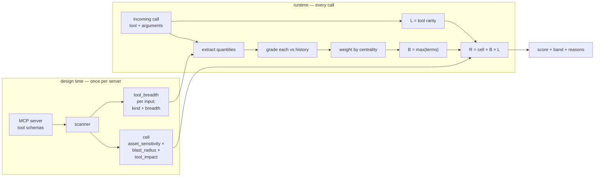
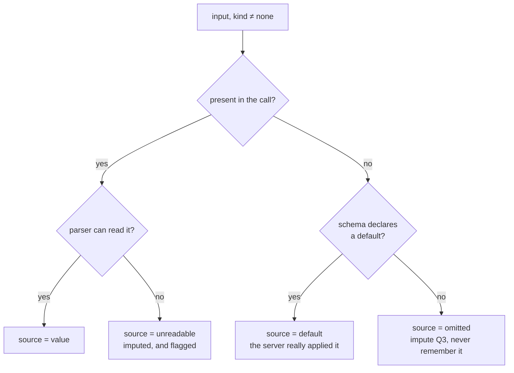
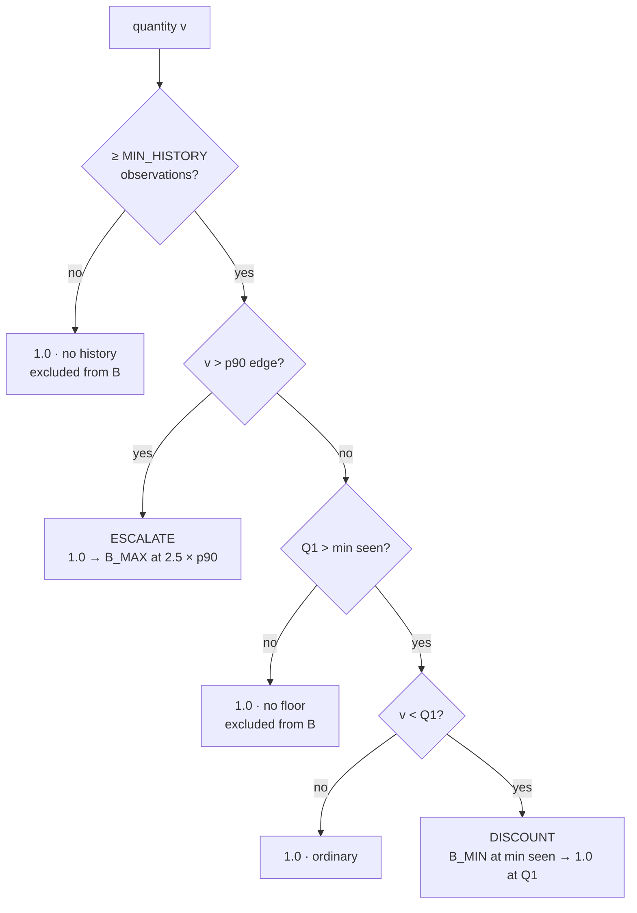

# The Dynamic Layer, Explained

Everything the runtime does to one call, in the order it happens, with the real numbers
from a real call at each step. Written against the code in
[`scripts/dynamic_design/dynamic_v2.py`](../../scripts/dynamic_design/dynamic_v2.py) and
[`src/mcp_security/scanner/breadth.py`](../../src/mcp_security/scanner/breadth.py).

For the protocol used to test it see [Evaluating the Dynamic Layer](evaluating-the-dynamic-layer.md);
for measured results see [v3 results](../../reports/experiments/dynamic_layer/v3/README.md).

## 1 · Where it sits

The final score for one call is the static cell adjusted by two runtime factors:

```
R(c) = min( 125 , cell(tool, asset) × B(c) × L(c) )
```

| | what it answers | reads | range |
|---|---|---|---|
| `cell` | how bad would this tool on this asset be? | the design-time scan | 1–125 |
| `B` | how far do this call's **arguments** depart from what this deployment asks for? | argument values vs their own history | 0.70 – 1.30 |
| `L` | how unusual is this **tool** for this deployment? | tool call counts | 0.85 – 1.30 |

`B` never looks at how often a tool is called and `L` never looks at argument values, so
neither can double-count the other and each can be evaluated separately.



**The split is deliberate.** Design time decides only *which arguments are quantities and
how central each is*. It is never asked "how big is too big" — that is a property of an
organisation, not of a tool, and only the runtime can know it.

## 2 · What the scan provides

`enrich_scan()` attaches `tool_breadth` to the scan artifact: two labels per input, judged
independently.

**`kind` — can a quantity be read from this value, and how?**

| kind | meaning | example |
|---|---|---|
| `count` | a collection; what matters is how many items | a list of file paths |
| `magnitude` | a single number; bigger means more work or data | a page size |
| `range` | one endpoint of an interval; the *span* is what matters | a window start |
| `none` | names one thing, switches a mode, or is content | a record id |

**`breadth` — how central is this input to the asset the call acts on?** 1–5, graded by
what changes when you change only that value:

| | changing this value means… |
|---|---|
| 5 | a different stored thing is acted on — or several at once |
| 4 | the same thing, but materially different contents are read or written |
| 3 | the same contents, in a different amount or slice |
| 2 | the same data, presented differently |
| 1 | nothing about the stored data changes |

The rubric contains no product nouns, so a server exposing datasets or tickets is
classified by the same question as one exposing repositories. Three override rules: a list
or pattern selecting stored things is 5 however few entries it carries; a filter *within*
something already selected is 3 however powerful; ties break downward.

**The two are independent.** An identifier is `kind: none` (one id is not larger than
another) and `breadth: 5` (it names the asset). Neither fact implies the other. Tying them
together pushed 66% of inputs into the bucket that weighs nothing purely because no number
could be read from them.

**Why not weight by `rank` instead of `breadth`?** An earlier version of this classifier
asked a third question: a listwise ordering of a tool's inputs by reach, largest first.
That field does not exist any more — `tool_breadth` carries only `kind` and `breadth`, and
[`tests/scanner/test_breadth.py`](../../tests/scanner/test_breadth.py)`::test_no_ordering_and_no_pointwise_risk_score_are_emitted`
asserts `"rank" not in entry` for every input the classifier produces.

It was dropped because it failed its own stability test. Reversing the order inputs are
presented in and asking again should not change an answer that is really about the inputs
rather than about the prompt — but measured over 24 tools, the ranking agreed with itself
at Kendall's tau **0.538 mean** under reversal, and went **negative** on the two largest
tools in the sample: `create-event` (23 inputs, τ = −0.37) and `update-event` (20 inputs,
τ = −0.47) — worse than a coin flip, on exactly the tools where getting the order right
matters most (`reports/experiments/breadth_spec/rank_stability.json`). Positional bias in
listwise LLM ranking is architectural — causal attention couples a candidate's score to
where it sat in the prompt — so a smaller prompt or a stricter retry does not fix this.

**`breadth` fixes `rank`'s specific failure mode, but is not itself proven stable — and
measured the same way, it isn't.** Removing the relative-comparison mechanism (nothing is
ranked against anything else) does not stop position from leaking into a reply the model
still generates in one pass over the whole input list. Run the identical forward/reversed
test on `kind` and `breadth` instead of `rank`
(`scripts/check_breadth_stability.py` → `reports/experiments/breadth_spec/breadth_stability.json`,
same 24 tools): `kind` holds up (94.7% mean agreement) but `breadth` does not — **62.5%
mean agreement, 59.8% median, only 3 of 24 tools identical**, with a mean swing of **1.2
levels** when it disagrees. `update-event`'s `account` goes from breadth 5 when it's first
in the list to breadth 1 when it's last — the same primacy signature that broke `rank`.
Unlike `rank`, this does **not** track tool size (Spearman ≈ 0.06 against input count) —
`usergroups_update`, 5 inputs, agrees with itself only 20% of the time. Identifiers that
plainly name the asset (`usergroup_id`, `eventId`, `calendarId`) hold steady either way;
it's the judgment calls in the middle of the 1-5 scale that drift.

`_relative_weight()` in §3.3 below is built entirely on `breadth`, which means it is built
on a field that disagrees with itself under reordering roughly 40% of the time — an open
reliability problem in the current design, not a resolved one. `rank` itself still
contributes nothing to `B`: there is no field left to weight by, and no code path in
`dynamic_v2.py` that reads one. Replacing it fixed *that* specific bug; it did not make the
replacement trustworthy by itself.

(A related field, `targets` — whether a value decides *which* stored thing a call acts on —
was dropped alongside it for a different reason: not instability, but scope. Which asset a
call can reach is priced into the static `cell`; folding it into `B` as well would
double-count it.)

## 3 · The runtime, stage by stage

Real example throughout — GitHub `list_issues`, warmed on 50,000 calls:

```json
{"owner": "To2004", "repo": "RubicCube", "state": "open", "per_page": 100, "page": 1}
```

What the scan says about this tool:

| input | kind | breadth | |
|---|---|---:|---|
| `owner`, `repo` | none | 5 | names the asset — no readable quantity |
| `state` | none | 4 | |
| `since` | range | 4 | |
| `labels` | count | 3 | |
| `per_page` | magnitude | 3 | |
| `page` | magnitude | 1 | |
| `direction`, `sort` | none | 2 | |

### 3.1 Extract the quantities

`quantities()` walks the tool's inputs and yields every one a number can come from.
Omission is handled explicitly, because a call that omits an argument still happened and
something was still in force:



Three rules that matter:

- **A declared default is fact, not imputation.** The server applied that value, so the
  call really did request it — it is scored *and* remembered.
- **No default, and the deployment does use the argument** → imputed at Q3, the high end of
  normal, so no discount is earned by omitting it. Imputed values are **scored but never
  remembered**, or the reference would learn from its own assumptions.
- **No default, and nobody ever passes it** → ignored entirely. Imputing here would charge
  every call for an argument this deployment never uses.

**`range` inputs are handled per call, not per argument.** A `timeMin` alone says nothing;
`timeMin` with `timeMax` says how much calendar the call sweeps. `span_of()` emits a
synthetic `<span:days>` quantity from the widest pair of endpoints. Measured on real
traffic this is the largest single class of quantity argument, and a per-argument parser
drops all of it.

**`kind` decides *whether* to look; the value's shape decides *how* to read it.** Real
classifiers disagree about whether `perPage` is a count or a magnitude, and a label-driven
parser silently dropped 100% of one server's quantities over that disagreement. Both
produce a number, which is all that matters here.

For the example call:

```
labels        omitted, no history      →  ignored
page          = 1                      →  quantity 1
per_page      = 100                    →  quantity 100
<span:days>   omitted, no history      →  ignored
```

### 3.2 Grade each quantity against its own history

`deviation()` compares one value against every value this deployment has passed for that
`(server, tool, argument)`. The history is a rolling window of the most recent
`MAX_HISTORY` values, kept sorted for quartiles and evicted in **arrival** order.

> Evicting from the sorted list instead drops the smallest value every time, which walks
> Q1 upward forever. Demonstrated: Q1 went 25 → 100 within 1,200 calls, the window
> collapsed onto one value, and every call silently scored the floor.



```
escalate   v > edge      B = 1 + (B_MAX − 1) × min( (v − edge) / (fence − edge), 1 )
                         edge  = 90th percentile of observed values
                         fence = 2.5 × edge
ordinary   Q1 ≤ v ≤ edge B = 1.0
discount   v < Q1        B = B_MIN + (1 − B_MIN) × (v − min) / (Q1 − min)
```

Two anchors, chosen for reachability rather than convention:

- **Lower anchor is the smallest value ever observed**, not Tukey's lower fence. These
  quantities are positive and right-skewed, so a Q1 of 5 with a Q3 of 75 puts the fence at
  **−100** — unreachable, and a call asking for 1 earned a 1% discount instead of 30%.
- **Upper anchor is a percentile, always**, never a rule that switches on whether the IQR
  is degenerate. `per_page` is 30 in 58% of calls, which collapses Q1 and Q3 onto the same
  value; a rule that branched on that made `per_page=100` flip between "ordinary" and
  "wide" as Q3 crossed, driving the noise floor from 0.009 to 0.130.

**Two verdicts exclude an argument from `B` entirely** rather than scoring it 1.0:

| verdict | meaning |
|---|---|
| `no history` | fewer than `MIN_HISTORY` observations — nothing to grade against |
| `no floor` | Q1 sits on the argument's own minimum, so no value could ever be narrow |

Excluding them matters because the combination below takes the *most alarming* verdict:
an argument scored 1.0 pins `B` to 1.0 for the whole tool. A page number is 1 in four calls
out of five, so its Q1 sits on its minimum — and every paged tool had `B` disabled outright
until this exclusion existed.

For the example: `per_page = 100` sits at the p90 edge exactly → **ordinary, 1.000**.
`page = 1` has Q1 = min = 1 → **no floor, excluded**.

```
per_page   n=2329  min=1  Q1=30  Q3=30  p90=100  fence=250
page       n=2329  min=1  Q1=1   Q3=1   p90=2    fence=5
```

### 3.3 Weight each deviation by centrality

A deviation on a minor argument should count for less than one on the argument that
decides which asset is touched:

```
w = BREADTH_WEIGHT[this argument] / BREADTH_WEIGHT[most central MEASURABLE argument]

BREADTH_WEIGHT = {5: 1.00, 4: 0.75, 3: 0.50, 2: 0.25, 1: 0.0}
```

**The denominator ranges over measurable arguments only.** Counting every argument sounded
more principled — the input naming the asset sets how central everything else is — but it
degenerates: the most central input is breadth 5 on **17 of 17 GitHub tools and 9 of 9
Calendar tools**, because every tool names its asset, and that input is always an
identifier with no readable quantity. Measurable arguments are breadth 3. So the ratio was
a constant `0.50 / 1.00` almost everywhere: a flat halving of every signal the runtime can
read, divided by a reference that can never itself contribute.

Measured cost: a widening deviation moved the score **+0.227** on GitHub with the old
denominator against **+0.348** with a flat rubric — the weighting was destroying a third of
the signal it was meant to shape. With the corrected denominator it is +0.348.

For the example, the most central measurable input on `list_issues` is `since` at breadth 4,
so `per_page` (breadth 3) gets `w = 0.50 / 0.75 = 0.67`, and `page` (breadth 1) gets `0.00`.

### 3.4 Combine into `B`

```
term_i = 1 − w_i × (1 − B_i)
B      = max over i of term_i          (1.0 if nothing was gradeable)
```

`max` is "the most alarming argument decides", and it reads correctly in both directions:
in the discount direction it takes the *least* discount, because a call wide in any one
dimension is not a narrow call; in the escalation direction the widest argument decides,
because one runaway quantity is enough.

For the example every term is 1.0000, so **`B` = 1.0000**.

### 3.5 Tool rarity → `L`

`L` reads only how often each tool has been called on this server.

```
reference  = (calls to the MEDIAN tool this deployment uses) / total calls
share      = (calls to this tool + L_ALPHA × reference) / (total + L_ALPHA)
ratio      = share / reference

ratio < 1  →  raw = 1 + (L_MAX − 1) × (1 − ratio)          rare   → up to 1.30
ratio > 1  →  raw = 1 − (1 − L_MIN) × (1 − 1/ratio)        common → down to 0.85

confidence = total / (total + MIN_HISTORY × tools_exposed)
L          = 1 + (raw − 1) × confidence
```

Three decisions, each with evidence behind it:

**The neutral point is the median tool this deployment calls.** Anchoring on an even split
over the whole exposed catalog put every tool a deployment actually uses above "even" — six
used tools out of thirteen exposed meant all six were "common", every call was discounted,
and *no call could ever score 1.0*.

**The discount side is half the escalation side** (0.15 below vs 0.30 above). Commonness
exonerating is the failure mode with history here: a symmetric likelihood measured
net-negative on all three servers, and per-identity conditioning collapsed misuse AUC
0.53 → 0.30. Rarity is evidence; commonness is not exoneration.

**The whole factor is shrunk toward 1.0 in proportion to evidence.** `B` refuses to grade
an argument below `MIN_HISTORY` observations; without the same guard, a fresh deployment
called a tool "0.79× the median" and escalated 6.4% on the evidence of **nine calls**.
Reusing `MIN_HISTORY` as the per-tool requirement means both factors demand evidence of the
same order. Half confidence lands at 520 calls for GitHub, 320 for Slack, 260 for Calendar.

For the example: `list_issues` has 2,329 calls against a median tool's 882, out of 50,000
over 26 exposed tools. Ratio 2.64, confidence ≈ 0.99, so **`L` = 0.9078** — a common tool,
mildly discounted.

### 3.6 The result

```
D = B × L = 1.0000 × 0.9078 = 0.9078
R = min(125, cell × 0.9078)
```

with a reason string that reconstructs every step:

```
per_page=100->1.00(b3,w0.67,ordinary); L=0.91(2.64x the median tool)
```

Scoring a call also **records** it — history updates strictly after the score is computed,
so a call is never graded against itself.

### 3.7 How much of the declared surface actually warms up

The scan can label an input `breadth`-graded and measurable; whether it ever reaches
`MIN_HISTORY` observations in practice is a separate question, decided by what the corpus
actually sends. Measured on the three 100,000-call corpora, warmed on the first 50,000:

| server | measurable inputs declared | reached `MIN_HISTORY` |
|---|---:|---:|
| github | 29 | 21 (72%) |
| slack | 22 | 11 (50%) |
| calendar | 44 | **4 (9%)** |

Calendar's gap is not spread thin across many tools — it concentrates on write tools.
`update-event` declares 11 measurable arguments (`attendees`, `reminders`, `recurrence`,
`conferenceData`, …); across 1,770 calls to it, **every one of the 11 is present in zero
calls**. `create-event` shows the same pattern. The cause is in the traffic generator, not
the runtime: `build_calendar_args()` in `org_traffic.py` populates only `calendarId`,
`eventId`, `summary` and `sendUpdates` for these tools, because those are what a
plausible write call needs — the schema exposes far more than any one call realistically
uses at once. `B` is doing exactly what it should with what it is given: an argument
nobody ever sends stays `no history`, excluded rather than guessed at.

The consequence for evaluation is direct. Every result in
[Evaluating the Dynamic Layer](evaluating-the-dynamic-layer.md) that touches Calendar's
write tools is running on the ~9% of that server's declared surface the generator actually
exercises — not on the schema's full richness. This is a property of the corpus, and it
belongs in the same category as the deviation sets in E3: something a genuinely
independent corpus, or arguments authored by someone other than the person who wrote the
generator, would need to confirm rather than assume.

## 4 · Every constant

| constant | value | why this value |
|---|---:|---|
| `B_MIN` | 0.70 | the discount floor, reached at the narrowest value ever observed |
| `B_MAX` | 1.30 | symmetric with `B_MIN` about 1.0, and matches `L_MAX` |
| `L_MIN` | 0.85 | deliberately half the escalation range — commonness is not exoneration |
| `L_MAX` | 1.30 | a tool never called |
| `L_ALPHA` | 30 | smoothing on tool share, so a fresh deployment does not read as all-rare |
| `MIN_HISTORY` | 20 | below this there are no meaningful quartiles; also sets `L`'s confidence scale |
| `MAX_HISTORY` | 4000 | bounded memory; the reference tracks what the deployment does *now* |
| `TUKEY_K` | 1.5 | standard outlier multiplier, used for the escalation fence |
| `ESCALATE_AT` | 90 | the percentile above which a value stops being a large ordinary one |
| `BREADTH_WEIGHT` | 5:1.00 … 1:0.0 | how much a deviation counts, by centrality to the asset |
| `DEFAULT_BREADTH` | 3 | used when the scan gave no level — neither silenced nor treated as widest |
| `SCORE_MAX` | 125 | the static matrix ceiling, 5 × 5 × 5 |

**Every one of these was chosen while looking at the three development servers.** That is
data snooping, and any number reported on those corpora is optimistically biased — see
[Claims and Defence](dynamic-layer-claims-and-defence.md) for what to do about it.

## 5 · A second call, for contrast

The same tool with `per_page` widened, everything else identical:

| `per_page` | per-argument verdict | `B` | `D` |
|---:|---|---:|---:|
| 1 | `0.70` narrow — the smallest value ever seen | 0.800 | 0.726 |
| 30 | `1.00` ordinary — sits on Q1 | 1.000 | 0.908 |
| 100 | `1.00` ordinary — sits on the p90 edge | 1.000 | 0.908 |
| 1,000 | `1.30` wide — past the fence at 250 | 1.200 | 1.089 |
| 1,000,000 | `1.30` wide, saturated | 1.200 | 1.089 |

The per-argument verdict spans the full `0.70 … 1.30`, but `B` only reaches `0.80 … 1.20`
because `per_page` carries `w = 0.67`: it is breadth 3 on a tool whose most central
measurable input, `since`, is breadth 4. That is the weighting doing its job — a page size
is not what decides which repository is touched.

Two properties worth seeing directly: the score is **monotone** in the quantity, and it
**saturates** rather than running away — a request for a million and a request for a
thousand-and-one are both simply "far outside what this deployment does".

## 6 · What it deliberately cannot do

**No state across calls.** No session, no clock, no rate. A call scored twice scores the
same both times. A burst of a thousand small calls is invisible; the threat model is a
legitimate agent doing too much in *one* call. Stated as a limitation, not hidden.

**No caller identity.** The score is per deployment, not per agent. Per-identity
conditioning was tried and collapsed misuse AUC from 0.53 to 0.30.

**No ownership check.** Whether *this* caller should reach *that* asset is the binding
layer's job. BOLA-class authorisation is out of scope by construction.

**Rarity is not malice.** `L` would score a rare read and a rare deletion identically. What
distinguishes them is the cell, not the runtime.

**A common tool used wrongly is the structural blind spot.** `get_file_contents` is 18% of
GitHub traffic; an agent walking every path in every repository through it keeps scoring
~0.86 because the tool is ordinary. Only `B` and the cell can catch that.

**It adapts, so it cannot be time-invariant.** Identical calls at different points in the
stream differ slightly as the baseline moves. Measured as the noise floor: p95 0.007–0.084
warm, and no comparison smaller than it is meaningful.

**It learns from traffic the adversary controls.** Normalising a rare tool costs ~882 cover
calls, after which it scores *below* 1.0 and the attacker is better placed than an ordinary
caller.

## 7 · Where each piece lives

| | file |
|---|---|
| design-time classifier | `src/mcp_security/scanner/breadth.py` |
| the runtime | `scripts/dynamic_design/dynamic_v2.py` |
| traffic model for corpora | `scripts/dynamic_design/org_traffic.py` |
| live corpus driver | `scripts/dynamic_design/make_org_live.py` |
| synthetic corpus | `scripts/dynamic_design/make_org_synthetic.py` |
| shape / noise floor / separation | `scripts/dynamic_design/report_org_run.py` |
| ablation, sensitivity, poisoning, controls | `scripts/dynamic_design/evaluate_dynamic.py` |
| tests | `tests/test_dynamic_v2.py`, `tests/test_org_traffic.py`, `tests/scanner/test_breadth.py` |
