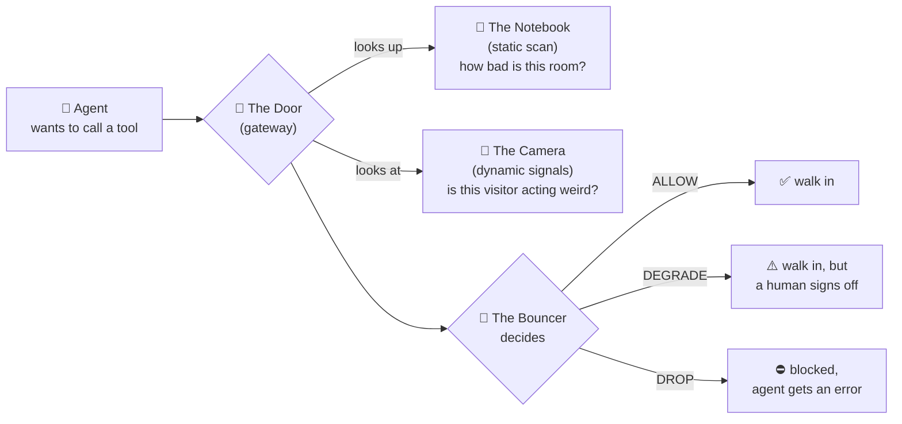
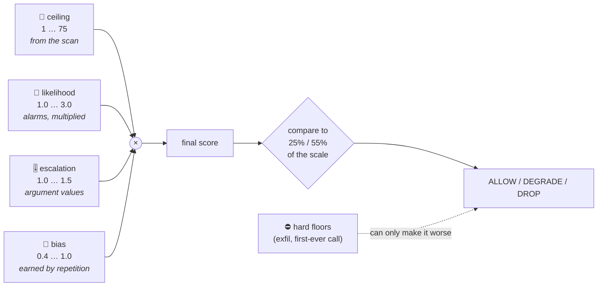
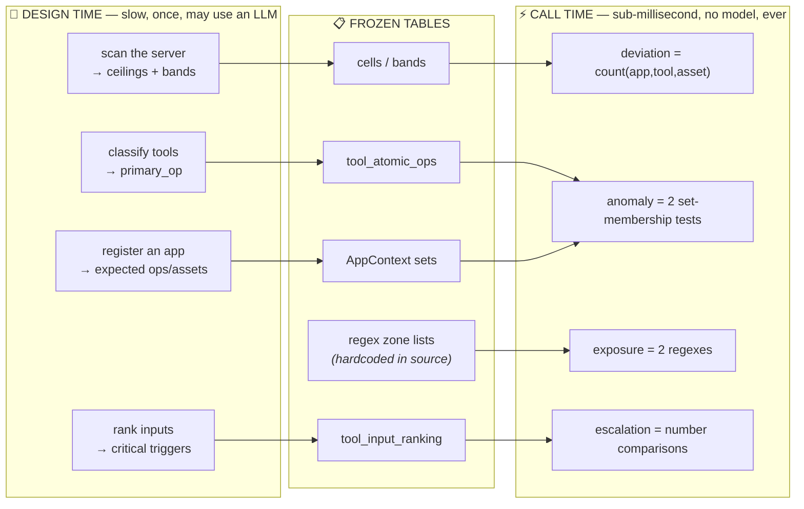
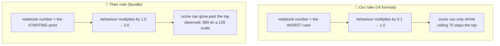
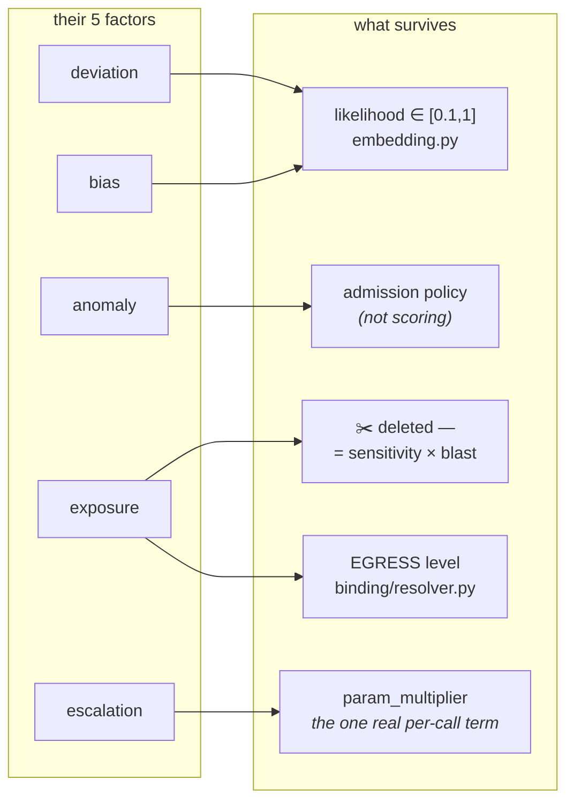
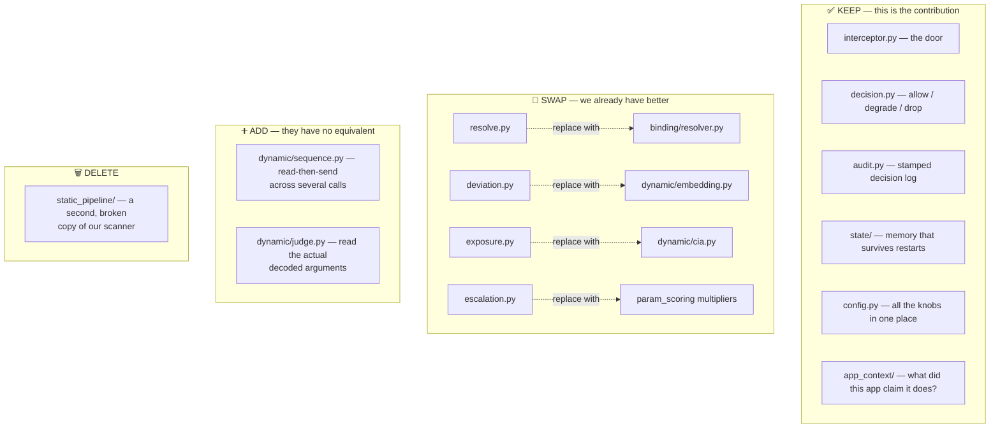

# The Gateway Bundle, Explained Simply

A plain-language review of `mcp_gateway_bundle.zip` — what our teammate built, what
is good, what is broken, and how it fits with the scanner we already have.

Everything below was checked by running the code, not just reading it.

## The story in one picture

Think of an MCP server as a **building full of rooms**. Some rooms are boring (a
public README). Some rooms are scary (the room with the private key in it). AI
agents are **visitors** who want to walk into rooms and take things.



Before this bundle we had **the notebook** (`scanner/`, `static_scoring/`) and
**the camera** (`dynamic/`), but no door — we could only watch a recording *after*
the visit and say "that was bad." Our teammate built **the door and the bouncer**.
That is the valuable part.

## What each piece does

| Piece | ELI5 | Where it lives |
|---|---|---|
| **Notebook** | "If someone gets into this room with this tool, how much damage?" A number, written once, ahead of time. | our `reports/scan/*.json` |
| **Camera** | "Is this visitor doing something unusual for *them*, right now?" | our `src/mcp_security/dynamic/` |
| **Door** | The thing standing in the hallway that can actually stop you. | bundle `gateway/interceptor.py` |
| **Bouncer** | Turns the notebook number + camera feed into yes / yes-but / no. | bundle `gateway/scorer.py` + `decision.py` |
| **Guest list** | "This delivery robot said it only does laundry." So laundry = normal, vault = weird. | bundle `app_context/` |
| **Memory** | Counts how many times this visitor did this exact thing before. | bundle `gateway/state/` |

## How the bouncer actually decides

### The shape of it

Every risk formula in this field is the same one sentence:

> **risk = how bad it would be × how likely it is that this is really an attack**

The first half is knowable **before** anything happens (it's a property of the room
and the tool). The second half is only knowable **while** it happens (it's a
property of this visitor, right now). That split is the whole reason we have a
static scanner and a dynamic scorer at all.

The bundle writes it as:

```
final = ceiling × likelihood × escalation × bias
         ↑          ↑            ↑           ↑
      the scan   the alarms   the knobs   the trust
     (offline)   (runtime)   on the call  (learned)
```



### What each term means, in words

**`ceiling` — "how bad would this be?"**
One number per (tool, asset) cell, precomputed by the scan. Nothing at runtime can
recompute it. It's the answer to *"if this call is malicious, what did we lose?"*

**`likelihood` — "how much does this smell?"**
Three independent alarms, each returning one of three values: **1.0 = quiet,
1.3 = something, 1.6 = definitely something**. They are **multiplied**, not added,
and the product is capped at 3.0.

| alarm | the question it asks |
|---|---|
| `deviation` | Has *this app* touched *this exact room* before? Never → 1.6. A few times → 1.3. Routinely → 1.0. |
| `anomaly` | Did the app *claim* it does this kind of thing? Wrong operation *and* wrong asset → 1.6. One of the two → 1.3. Both fine → 1.0. |
| `exposure` | Do the arguments describe something sensitive flowing somewhere public? Yes → 1.6 **and a hard block**. Merely touching something sensitive → 1.3. |

Why multiply? Because independent suspicions **compound**. Two mild oddities
(1.3 × 1.3 = 1.69) are treated as worse than one glaring one (1.6) — which is
usually the right instinct, since a real attack lights up several axes at once and
a false alarm normally lights up one. The cap at 3.0 stops any single call from
running away to infinity.

### "But we don't use an LLM at runtime — so how do the alarms know anything?"

They don't *know* anything. **The thinking already happened, offline, months earlier.
At runtime the alarms are three lookups into tables somebody else filled in.**



The literal runtime cost of one decision is: **three dictionary lookups, two set
tests, two `re.search` calls, and one `math.exp`.** Nothing else. `grep` for any
model client in `gateway/` returns nothing.

Alarm by alarm:

| alarm | the actual runtime mechanism | where its table came from |
|---|---|---|
| `deviation` | `store.count(app, tool, asset)` — one integer, incremented by the gate itself | nowhere: **the gate writes it** as it runs |
| `anomaly` | `primary_op not in expected_ops` / `asset not in expected_assets` — two set tests | `primary_op` from our `tool_atomic_ops` (**148 rules-based, 17 verb-fallback, 0 LLM**); the expected-sets from an LLM once per app at registration, with a deterministic keyword fallback |
| `exposure` | `re.search(sensitive, v)` / `re.search(public, v)` over the string arguments | a **hardcoded table of ~12 words per server kind**, typed by hand into `exposure.py` |
| `escalation` | `isinstance` + `>=` comparisons | our `tool_input_ranking` — **165/165 LLM-produced**, offline, at scan time |
| `bias` | `1 − (1 − e^(−0.15n)) × floor` | its own counter + the band from the scan |

So the honest one-liner is: **the LLM's judgement is baked into constants, and the
runtime is arithmetic over those constants.** That is the same architecture we
already committed to — it's why `binding/discovery.py` says *"no model runs on the
call path, so a decision costs nothing, reproduces exactly, and cannot be steered by
text an attacker places in an argument."*

Three consequences worth being clear about:

- **Good: no prompt injection into the gate.** Attacker-controlled argument text
  never reaches a model, so it cannot talk the gate into allowing anything. It also
  means a decision is reproducible — replay the same call against the same tables
  and you get the identical verdict, which is what makes the audit log evidence.
- **Bad: deterministic is not the same as untamperable.** `exposure` and the
  resolver still *read* attacker-controlled strings, with regex and substring
  matching. That's how `README.md.evil` inherits `README.md`'s cheap ceiling. No
  model was fooled — the string matcher was.
- **Bad: the gate inherits every offline mistake, frozen.** If the scan mis-rated a
  cell, or the LLM wrote a bad `critical_trigger`, nothing at runtime re-examines
  it. This is exactly why the artifact fingerprint in every decision matters, and
  why the proposer/judge cross-check at scan time is the real safety backstop.

And one caveat about the numbers themselves: **1.0 / 1.3 / 1.6 / 3.0 / 0.75 / 0.15
are hand-picked placeholders.** `config.py` says so in a comment — *"values are
placeholders pending calibration."* They didn't come from a model or from data. The
*mechanism* is sound; the *constants* are currently guesses, and that is one more
reason to run the thing against the testbed before anything is claimed about it.

**`escalation` — "how big is the blast on this particular call?"**
Not *whether* you're deleting, but *how much*: 40 files instead of 1, `recursive=true`,
an amount over 100,000. Always ≥ 1.0 — it can widen the damage, never narrow it.

**`bias` — "have you earned any trust?"**
The **only** term that can be below 1.0, and the only one that looks at history:

```
bias = 1 − routine × (1 − floor)          routine = 1 − e^(−0.15 × n)
```

`n` is how many times this (app, tool, asset) was allowed before. `routine` climbs
from 0 toward 1 with diminishing returns. `floor` is set by the cell's static band —
**0.75 for critical/high, 0.5 for medium, 0.4 for low**.

That floor is the important idea, and it's the same one we implement as the
impact-aware reference filter in `embedding.py`: **a dangerous room can never be
made to look safe just by being visited often.** A low-risk cell can relax to 40% of
its score; a critical one can never go below 75% of it, no matter how routine it
becomes. Below 5 observations `bias` stays 1.0 — you can't buy trust with three
polite knocks.

### Then the decision

```
frac = final ÷ score_max        (score_max = 75 for our v6 formula)

frac ≥ 0.55  →  DROP
frac ≥ 0.25  →  DEGRADE
otherwise    →  ALLOW
```

…with two overrides that ignore the arithmetic entirely:

- **A hard floor from any alarm.** A confirmed sensitive→public flow says DROP no
  matter what the number came out to. This is the "some things are just not okay"
  rule, and it's a good one.
- **Novelty.** A first-ever call by an app is never silently allowed — at minimum
  DEGRADE.

And one feedback rule that matters more than it looks: **only ALLOW and DEGRADE
write to memory. DROP never does.** A blocked call must never teach the system that
it was normal.

### One real call, all the way through

From `fs_corp_filesystem.json`, a bot converting a file format:

```
write_file(path="projects/known_defects.csv",
           destination="projects/known_defects.json")

ceiling      18.0   ← the (write_file, known_defects.csv) cell from the scan
deviation     1.6   ← this bot has never touched this file
anomaly       1.3   ← the bot never registered a declared purpose
exposure      1.3   ← "the extension changed — that looks like disguise"
             ─────
likelihood    2.70  = 1.6 × 1.3 × 1.3
escalation    1.00  ← no bulk, no flags, no big numbers
bias          1.00  ← n = 0, no trust earned yet
             ─────
final        48.7   = 18 × 2.70 × 1.00 × 1.00
frac          0.65  → over 0.55 → DROP
```

A routine `csv → json` conversion, blocked. Notice **the ceiling was only 18** — a
middling cell — and three soft 1.3-ish suspicions multiplied it past the block
line. That's the multiplication doing its job *too* eagerly, on evidence that was
weak (the "disguise" rule is just "two arguments have different file extensions").

### Where the formula stops listening

Because everything except `bias` is ≥ 1.0, and `bias` is floored, you can derive the
exact ceiling above which behaviour cannot change the answer:

| condition | meaning | at score_max = 75 |
|---|---|---|
| `ceiling ≥ 0.55 × max` | DROP on the very first call | ceiling ≥ **41.2** |
| `ceiling × floor ≥ 0.55 × max` | DROP forever, no matter how routine | ceiling ≥ **55.0** |
| `ceiling × floor ≥ 0.25 × max` | can never reach ALLOW | ceiling ≥ **25.0** |

Measured across all 13 of our real scans (2,094 scored cells):

| | share of cells |
|---|---|
| DROP on arrival | **2%** |
| DROP forever, behaviour irrelevant | **1%** |
| Can never reach ALLOW | **7%** |
| **Live zone — dynamics genuinely decide** | **93%** |

So the "the camera doesn't matter" problem is **narrow but pointed**: it hits about
1-2% of cells — and those are precisely the crown-jewel cells (private keys,
payroll, prod) that the system exists to protect. For the other 93% the dynamic
layer really is doing the deciding. Worth fixing, not worth panicking about.

### The two rulers, conceptually

Both formulas are `impact × likelihood`. The disagreement is about **what
`likelihood = 1` means**:

| | our v6 formula | the bundle |
|---|---|---|
| `likelihood = 1` means | "assume the worst — this *is* an attack" | "nothing looks wrong here" |
| the scan number is | the **ceiling** (the worst case) | the **neutral** case |
| runtime evidence | pulls **down** toward 0.1 | pushes **up** toward 3.0 |
| the scale | anchored at the top: 75 is the max, always | unanchored: observed 300 on a 125 scale |
| you must prove | that a call is *normal* | that a call is *bad* |

Both are internally coherent. Ours is the one where `score_max` keeps its meaning —
which is what every band threshold, every heatmap, and every table in the paper is
built on. Theirs is the one where a "suspicious enough" call can be pushed past any
threshold you set, which is why their top band saturates into one undifferentiated
blob.

**The merge:** keep our direction — the scan is the ceiling, one likelihood term in
`[0.1, 1.0]` (our `embedding.py`, floored by band exactly as their `bias` is) — and
bring their alarms in as **`floor_action` rules** rather than as multipliers. An
alarm then doesn't distort the number; it says *"whatever the number says, this one
needs a human."* That keeps the scale honest **and** keeps the part of their design
that is genuinely new.

## The good news

1. **The door and the bouncer are real and they work.** Four demo sessions
   (filesystem, Slack, GitHub, payments) run end to end.
2. **The bouncer can say three things, not two** — `ALLOW`, `DEGRADE`, `DROP`.
   "Let them in but wake a human" is exactly the middle option we were missing.
3. **Every decision is stamped with which notebook it read** (a fingerprint of the
   scan file). So you can always prove *why* a call was blocked, months later.
4. **Memory survives a restart** (Redis option), instead of being rebuilt from a
   folder of CSVs each time.
5. **The teammate reached the same conclusion we did about direction:** danger
   signals should only ever *raise* risk, never hand out discounts. Two people
   arriving at the same rule independently is a good sign the rule is right.

## The bad news

### 1. For scary rooms, the camera doesn't matter

The bouncer's rule is: *if the number is more than 55% of the maximum, block.*
But the notebook's number for a scary room is **already** above 55%. So the
camera's opinion changes nothing.

I made a good, well-behaved agent write to a sensitive folder **200 times in a
row**. Every single time:

```
DROP   score=124.8   deviation=1.60   bias=1.00
reason: "first-ever call by this app (cold-start); never seen this before"
```

On visit number 200 the bouncer still says *"I've never seen you before."* Why?
Because blocked visits are never written into memory — so the counter is stuck at
zero forever. The door is really a **locked door with a camera pointed at it**.

How wide is this? Measured across all 13 scans: **1-2% of cells**, and 93% are in
the live zone where behaviour genuinely decides (see the table in *Where the formula
stops listening* above). Narrow — but it is exactly the crown-jewel cells.

### 2. Two rulers pointing opposite ways

This is the most important problem, and it is not a small one.



Same slot in the formula, opposite direction. Ours says *the notebook is the
ceiling*; theirs says *the notebook is the floor*. That is why their scores run off
the end of the scale (I measured 300 out of a possible 125) and why everything
above 55% squashes into one indistinguishable "very bad" blob.

**One of the two has to go.** My recommendation is to keep ours (the ceiling
version, which our whole paper is built on) and take their alarms in as *"force a
human to sign off"* rules rather than as number multipliers.

### 3. Trust is bought too cheaply

The bouncer gives a discount for repetition: do the same thing ~10 times and your
score drops by half. But the counter goes up from **the bouncer's own decisions** —
so a patient attacker does ten boring calls on a room, earns the discount, then
does the bad one on that same room. Nothing ever expires, either. (There *is* a
"forget old stuff" setting, but it is never actually passed to the memory store —
a one-line bug.)

### 4. It recognises rooms by fuzzy name-matching

The way it figures out *which room you're entering* is basically "is one name
inside the other?" That breaks in both directions:

```
projects/newfile.txt      →  resolved to  "/"          (should be "projects/")
README.md.evil            →  resolved to  "README.md"  (a made-up file inherits
                                                        the safest room's rating)
```

The `"/"` one happens because a `/` character appears inside every path. The second
one is worse: an attacker picks a filename and gets charged the cheapest room's
price. **We already solved this properly** in `binding/resolver.py`, which
deliberately cannot be steered by text an attacker puts in an argument.

### 5. The danger detector is a list of scary words

It looks for words like `secret`, `public`, `external` in the arguments. So:

- Rename your destination to remove the word "public" → the hard stop stops firing.
- Convert an ordinary `report.csv` into `report.json` → **blocked**, because the
  file extension changed and that looks like "disguise."

Word lists are easy to dodge and easy to trip by accident. Our `cia.py` asks a
better question: *does this call attack the thing this asset actually exists to
protect?*

### 6. Nobody has measured it

There are **zero tests** in the bundle. The four demo scripts are hand-written
stories with the expected answer typed in as a comment. There is no false-positive
rate, no false-negative rate, no number. For the paper, that is the only thing that
counts.

## Four objections to the likelihood term — all of which hold

Reviewing the factors one at a time against what our scan already computes, most
of the "dynamic" engine turns out to be either static, redundant, or ours already.

### "How do you even know which app is calling?"

**You don't — it is asserted, never derived.** `MCPCall.app_id` is filled in by
"the transport layer (from the session/auth, not from the payload)"; in the demo
scenarios it is passed in by hand. On our side the equivalent is the `persona`
column in a CSV we authored ourselves.

MCP the protocol carries **no app identity**. In a real deployment it comes from
the connection — one stdio process per client, or an API key per client over HTTP.
That is workable but must be written down as an assumption, because:

- two agents sharing one connection are indistinguishable, and
- an attacker who compromises an agent inherits that agent's entire trust history.

Both `deviation` and `anomaly` are keyed on the app, so weak identity weakens two
of the three alarms at once.

### "`anomaly` knows what the tool does, not what the call does"

Correct, and **half of it is a constant.** `artifact.primary_op(tool)` takes only
the tool name — no arguments. So `op ∉ expected_ops` is a fixed property of the
(app, tool) pair that never varies between calls; it could be precomputed once at
registration and carries zero runtime information. Only the asset half varies per
call, and that is entirely the resolver's output.

`anomaly` is therefore not a dynamic signal — it is an **authorization policy** in
a likelihood costume. Legitimate, but it belongs at admission control (a per-app
tool allow-list checked before scoring), not multiplied into the number.

### "`exposure` is just my blast radius"

**Two-thirds right.** Split into what it actually tests:

| what `exposure` checks | already in our scan? |
|---|---|
| the source is sensitive | **yes** — `asset_sensitivity` (1-5), a factor in the v6 formula |
| the damage spreads far | **yes** — `blast_radius`, keyed `"tool\|asset"`, precomputed per cell |
| the **destination named in this call's arguments** is outside the org | **no** — destinations only exist at call time |

Two of three are pure double-counting against `sensitivity × blast_radius`. The
third is real information the scan cannot have — and we already implement it
properly as the **EGRESS** level of `binding/resolver.py`, which admits egress
assets only when the call carries an identifier outside the deployment's own
domains. So: delete the factor; keep the idea, in the place we already put it.

### "The only genuinely new thing is the input limits — and that is `escalation`"

Agreed, and this is the sharp point. `tool_input_ranking` / `critical_trigger` is
the **only** term that varies with actual argument *values* and cannot be derived
from the cell. Same tool, same asset, same cell — 40 files instead of 1,
`recursive=true`, an amount over 100,000 — different damage. That is the real
per-call contribution of the parameter dimension.

### "`bias` should be inside `likelihood`"

Yes — and arithmetically it already is. Multiplication is associative:

```
ceiling × L × escalation × bias   ≡   ceiling × (L × bias) × escalation
```

The split was presentational, so that every *factor* could be described as ≥ 1.0.
Conceptually `bias` answers *"how likely is this an attack given what this app has
done before"* — which is the definition of a likelihood term. Our v6 formula has
exactly one `likelihood` slot, in `[0.1, 1.0]`, floored by band. That slot is
`bias`'s job, and `embedding.py` already fills it with a far better estimator.

### What the engine collapses to



Leaving:

```
score = asset_sensitivity × blast_radius × likelihood × tool_impact × param_multiplier
                                            ↑ [0.1, 1.0], from observed history,
                                              floored by band
      + categorical floors:  egress → needs a human
                             first-ever call → needs a human
```

That is **our v6 formula, plus the parameter multiplier we already have, plus
action floors.** Which is the same conclusion as the rest of this review, reached
from the other direction: *the scoring model was already right; what the bundle
actually contributes is enforcement.*

## So what do we keep?



Every factor in their engine plugs in behind one small interface
(`LikelihoodFactor`), so swapping our modules in is genuinely easy — that part of
the design is good.

## How hard is it to hook up to our scans?

Not hard. Their loader currently **rejects** our real scan files:

```
StaticArtifact.from_table(our_scan)  →  ArtifactError: artifact missing 'asset_ids'
```

Three lines fix it — add `asset_ids`, add `score_max = 75`, and rename
`tool_atomic_ops` → `tool_impact_detail`. After that it loaded
`fs_corp_filesystem.json` (14 tools × 15 assets) and scored calls correctly.

Two things to watch:

- Their cut-offs are *percentages* (25% / 55%); ours are *absolute* (`medium: 8`,
  `high: 24` on a 75-point scale). Use ours.
- 35 of our 165 tool entries have an empty `tool_input_ranking`, and when it is
  empty both their room-finder and their parameter alarm quietly fall back to a
  hardcoded list of guessed argument names.

## The one-paragraph version

He built the part we were missing — a door that can actually stop a call, with
three answers instead of two, an audit stamp, and memory that survives a restart.
The eyes and ears he wired into it are weaker than the ones we already have, and
his arithmetic points the opposite way from our v6 formula, so the two cannot both
be right. Keep the door, throw away the eyes and ears, settle the ruler question,
fix four small bugs, and then run the whole thing against the 16.6k-call testbed so
there is finally a number attached to it.
