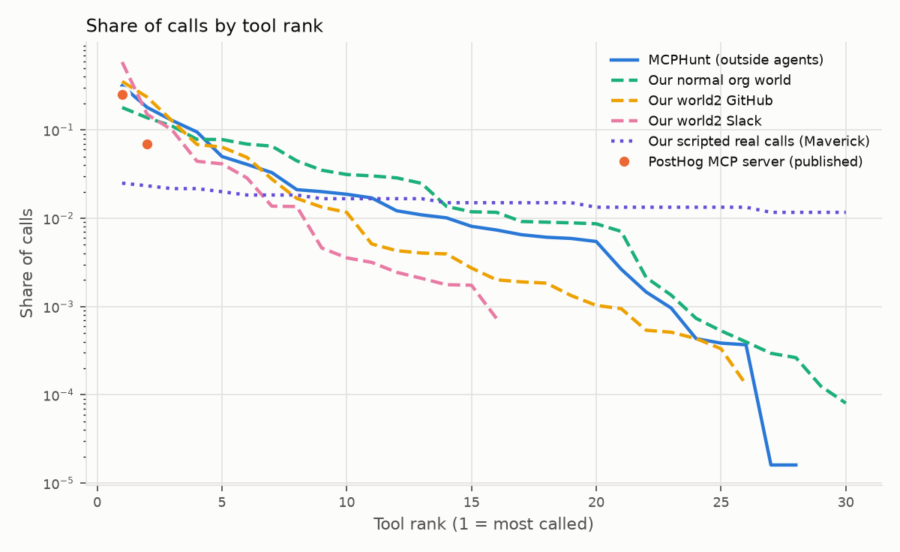
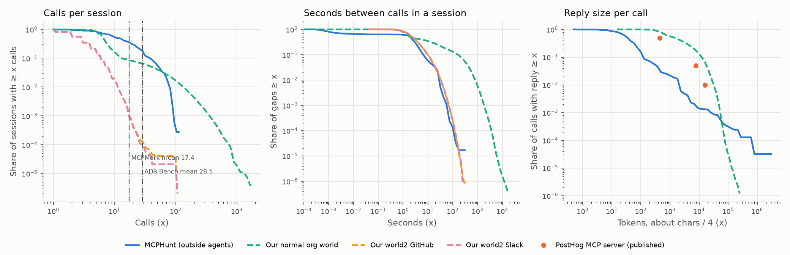
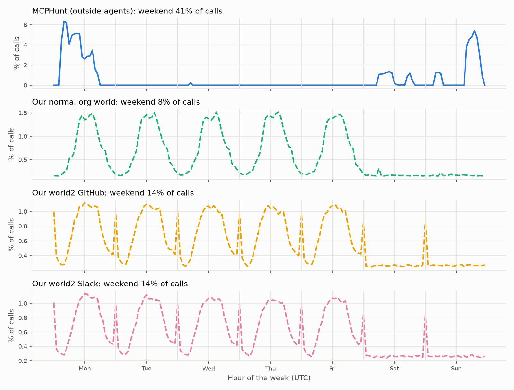

# Call distributions: what MCP traffic looks like

This folder measures how MCP tool calls are distributed, and what shape each distribution has. It covers five distributions: which tools get called, how many calls a session holds, the time between calls, reply size, and time of week. Each is measured on outside traffic (MCPHunt's recorded agents), on our simulated organisations, and on our earlier corpora, then set beside the few published numbers (PostHog's MCP server, MCPMark, ADR-Bench). It answers one question: does the traffic we simulate have the shape real agent traffic has?

## What is here

| File | What it is |
|---|---|
| `results.json` | Every corpus's summaries, shape fits and curves, plus the published numbers |
| `results.md` | The generated tables (all 16 corpora) |
| `tool_mix.png` | Share of calls by tool rank, log scale |
| `tails.png` | Log-log tails of calls per session, seconds between calls, and reply size |
| `time_of_week.png` | Calls by hour of the week (UTC), one panel per corpus with real times |

Scripts: [`scripts/call_distributions.py`](../../../scripts/call_distributions.py) (measure and fit) and [`scripts/plot_call_distributions.py`](../../../scripts/plot_call_distributions.py) (draw). Tests: `tests/test_call_distributions.py`.

## The corpora

| Corpus | What it is | Has |
|---|---|---|
| **MCPHunt** | 62,332 recorded calls by five models (MiniMax M2.7, DeepSeek V4 Flash, Gemini 3.1 Pro, GPT-5.2, GPT-5.4), 3,615 runs, 8 real servers ([experiment](../gateway/mcphunt/README.md)) | Tools, runs, times, reply size, success |
| **Normal org world** | Our mostly-ordinary GitHub organisation (`normal_org_world.py`, v5 rows): 150 agents, 180 days, 3.3M calls; seed 7, as in `normal_org_sim.py` | Tools, sessions, times, reply bytes |
| **World2 GitHub / Slack / Calendar** | Our multi-server worlds (`w2/*_M.csv.gz`): 50 agents, 730 days, 1.6-1.8M calls each | Tools, sessions, times |
| Persona corpora (100k) | `real_benign/*_org_100k.csv`: the persona call mix, no time | Tools |
| Scripted real calls | `real_benign/*_real.csv`, `real_benign_finance/*_real.csv`: our scripts calling real servers, read-only | Tools, success |
| **PostHog** (web) | 63M calls to PostHog's MCP server over 90 days, published totals only | Top tools, reply tokens, error rates |
| MCPMark, ADR-Bench (web) | Benchmark papers: mean calls per task | One mean each |

## What each graph looks like

### 1. Which tools get called: a steep geometric long tail



On a log scale the share of calls falls in a nearly straight line with rank, so each tool gets about three quarters of the share of the one above it. That is a geometric (exponential) fall, not a Zipf power law. It fits better than Zipf in 13 of the 16 corpora.

| | Top-1 tool | Top-3 | Tools for 80% of calls | Tools used | Next tool's share vs previous |
|---|---|---|---|---|---|
| MCPHunt | 32% (`read_file`) | 63% | 6 | 28 of 66 (42%) | 0.76 |
| PostHog | 25% (SQL); 2nd 7% | — | — | "agents ignore 95% of what we built" | — |
| Our normal org world | 18% | 43% | 10 | 30 of 30 (100%) | 0.78 |
| Our world2 GitHub | 36% | 72% | 5 | 26 | 0.76 |
| Our world2 Slack / Calendar | 59% / 54% | 84% / 84% | 3 / 3 | 16 / 13 | 0.68 / 0.53 |
| Our scripted real (Maverick, 94 tools) | 2.5% | 7% | 61 | 94 | 0.98 |

- **The shape matches.** Our worlds fall off at the same rate as MCPHunt (0.76-0.78).
- **The catalog coverage does not.** Real agents leave most of a server's tools unused: MCPHunt used 42% of them, and PostHog reports 95% ignored. Our worlds call every tool they have.
- **Our scripted real-server corpora are flat.** The scripts sweep tools nearly evenly, so their tool mix is not agent behaviour; they are useful only for argument values.

### 2. Calls per session: right-skewed, lognormal



The left panel shows the share of sessions with at least x calls, on log-log axes.

- **MCPHunt** is a clean lognormal (KS 0.04): median 11, mean 17.2, p90 38, p99 79. Its mean matches MCPMark's published 17.4 calls per task. ADR-Bench reports 28.5. The models differ:
  - DeepSeek V4 Flash: median 32.
  - The other four: medians 9-10.
  - GPT-5.2 and GPT-5.4 never pass 30 calls. That is a turn budget in MCPHunt, so its tail is cut.
- **Our world2 sessions are short**: median 3, p99 11, about a quarter of an agent's run.
- **Our normal org world mixes two shapes** (no single fit holds, KS 0.24):
  - Most sessions are short: median 6, p90 13.
  - All-day desktop sessions make a heavy tail to 1,667 calls (tail index 1.3).
- **No production source publishes session lengths** (PostHog does not), so the long-session tail has nothing to check against.

### 3. Seconds between calls: a burst, then think time

The middle panel shows the gaps.

- **MCPHunt has two parts.**
  - 37% of gaps are under 0.1 s. These are calls the model sent together in one turn; 47% of its calls arrive in such multi-call turns.
  - The rest is lognormal think time: median 3.0 s, p90 9.2 s, p99 30 s.
- **Our worlds have no bursts** (0-0.2% of gaps under 0.1 s).
- **Their think time is right.** World2's median is 2.2-2.4 s and its p99 32 s, close to MCPHunt.
- **The normal org world adds human pauses** inside long sessions (p90 165 s).

### 4. Reply size: lognormal body, heavy tail

The right panel shows reply size, with chars and bytes divided by 4 to compare with PostHog's tokens.

| | Median | p95 / p99 | Heaviest calls' share of all reply volume | Tail index |
|---|---|---|---|---|
| PostHog | 440 tokens | 7,800 / 16,000 tokens | One tool group: 0.5% of calls, 18% of tokens | — |
| MCPHunt | 138 chars (~35 tokens) | — / 7,857 chars (~2k tokens) | Top 0.5%: 74%. The ten largest (shell `curl` downloads of package JSON): 49% | 0.96 (very heavy) |
| Our normal org world | 5,753 bytes (~1.4k tokens) | — / 127,517 bytes (~32k tokens) | Top 0.5%: 5.7% | 2.9 (light) |

- **The real sources are heavy-tailed.** In both PostHog and MCPHunt, a few huge replies carry much of the volume.
- **Our world's replies are too even.** Its typical reply is about 3× PostHog's, but there are no rare giants.
- **MCPHunt's replies are small** because its workspace files are small.

### 5. Time of week: only our worlds have a work rhythm



- **Our worlds show five office-hour humps.** The weekend is 8% of calls (normal org world) and 14% (world2). World2 also has a midnight-UTC spike every day from its scheduled bots.
- **MCPHunt's clock is its collection schedule.** It was run in batches, 41% of them on a weekend.
- **No outside source publishes this**, so the weekly shape of our worlds is unchecked.

### Failures

| Source | Calls that fail |
|---|---|
| MCPHunt | 11.8% |
| PostHog, by client | 2% (Codex) to 5.7% (Claude Code) |
| PostHog, by tool | SQL 4.4%; the schema tool 1.5% |
| Our scripted real calls | 0-40%, from our own argument generator |
| Our worlds | No failures modelled |

At PostHog, 39% of failures are followed by a call to the same tool.

## What this means for our simulated organisations

Some of the shape matches outside traffic and some does not.

- **Right:**
  - the steepness of the tool mix;
  - lognormal sessions and gaps;
  - think-time pacing of about 2-3 s.
- **Missing, in order of how much it matters to the dynamic layer:**
  1. **Bursts.** Real agents send several calls in one turn. A rate limit tuned on our worlds would see these as spikes.
  2. **Unused tools.** Real agents leave half or more of a server's tools unused. In our worlds every tool is in use, so a first call to a rarely used tool looks ordinary there and would not in real traffic.
  3. **Failures and retries.** Real traffic has a 2-12% failure rate, and retries of the same tool follow.
  4. **Rare giant replies.**
  5. **Session length.** World2's sessions are a quarter of an agent's run. The normal org world's long sessions have no outside check.

## Limits

- **MCPHunt is benchmark tasks, not a working day.** Its runs are single tasks with a turn cap, collected in batches. Its tool mix and pacing are real model behaviour; its sessions and clock are the benchmark's.
- **PostHog is one server, and only totals.** It gives no curves, so its points are drawn as markers.
- **Tokens are taken as chars / 4.** This is a rough English average, used only to put the three reply scales on one axis.
- **Gaps are measured differently.** MCPHunt's gaps are between recorded call end times; our worlds' gaps are between request times.
- **Shape fits are maximum likelihood with location fixed at 0, on at most 100,000 values each.** The best shape is chosen by AIC, and the tail index is a Hill estimate over the top 5%.

## Re-run

```bash
uv run python scripts/call_distributions.py --out reports/experiments/call_distributions   # ~1.5 min
uv run --with matplotlib python scripts/plot_call_distributions.py \
    --results reports/experiments/call_distributions/results.json
```

Matplotlib is not a project dependency; `--with` installs it for the one run. MCPHunt's traces must be downloaded first ([`external/mcphunt/SOURCE.md`](../../../external/mcphunt/SOURCE.md)).

## References

- PostHog, "How AI agents behave" (63M MCP tool calls): https://posthog.com/blog/how-ai-agents-behave
- MCPMark (arXiv:2509.24002), "16.2 execution turns and 17.4 tool calls per task": https://arxiv.org/abs/2509.24002
- ADR-Bench (arXiv:2605.17380), "302 realistic tasks averaging 28.5 tool calls per task": https://arxiv.org/html/2605.17380
- MCPHunt traces: https://huggingface.co/datasets/mcphunt-benchmark/mcphunt-agent-traces
- Searched and found no published per-call distribution curves for MCP traffic. Vendor dashboards (SigNoz, Document360, Zuplo) describe the metrics they track but publish no data.
